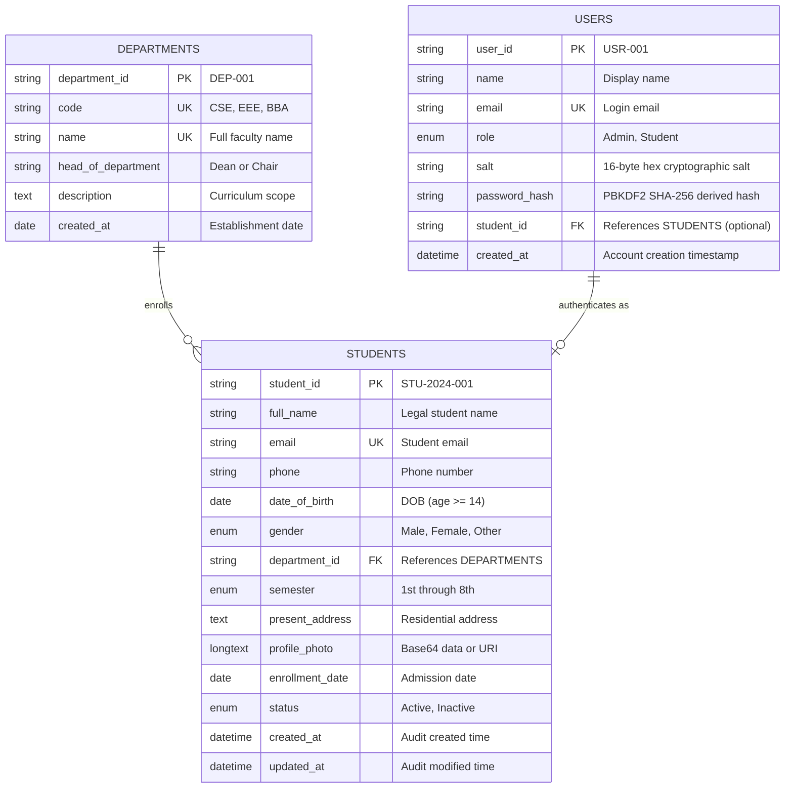

# Logical Entity-Relationship (ER) Diagram & Architecture

**Project:** Student Management System (EduMetrics SMS)  
**Target Environment:** Vanilla JavaScript (ES6+), HTML5, CSS3, Browser LocalStorage  
**Academic Reference Database:** MySQL 8.0+  

---

## 1. Logical Entity-Relationship Diagram



---

## 2. Cardinality & Relationship Analysis

### A. `DEPARTMENTS` to `STUDENTS` (One-to-Many: `1 : N`)
* **Relationship Description:** Each department can have multiple enrolled students (`0` or more).
* **Foreign Key:** `students.department_id` references `departments.department_id`.
* **Referential Integrity Rule:**
  * **On Update:** `CASCADE` (if a department ID changes, all linked students are updated).
  * **On Delete:** `RESTRICT` (a department cannot be deleted if active students are assigned to it).
  * **Client-Side Implementation:** In `settings.js`, when an administrator clicks "Delete Department", the system inspects `sms_students` to calculate matching references. If `studentCount > 0`, the action is blocked with an explicit error notification.

### B. `USERS` to `STUDENTS` (One-to-Zero-or-One: `1 : 0..1`)
* **Relationship Description:** 
  * An administrator account (`role = 'Admin'`) has `student_id = NULL`.
  * A student portal account (`role = 'Student'`) references exactly one student record in `sms_students`.
* **Foreign Key:** `users.student_id` references `students.student_id`.
* **Referential Integrity Rule:**
  * **On Update:** `CASCADE`.
  * **On Delete:** `SET NULL` (if a student record is removed, the user login account remains valid, but their profile link is nullified).

---

## 3. Data Dictionary

| Table / Key | Field Name | Data Type | Nullable | Key / Constraint | Description |
|---|---|---|---|---|---|
| **departments** (`sms_departments`) | `department_id` | `VARCHAR(16)` | NO | **PK** | Unique identifier (e.g. `DEP-001`) |
| | `code` | `VARCHAR(10)` | NO | **UNIQUE** | Short code (e.g. `CSE`, `EEE`) |
| | `name` | `VARCHAR(128)` | NO | **UNIQUE** | Full title of academic department |
| | `head_of_department` | `VARCHAR(100)` | YES | None | Faculty chair or dean |
| | `description` | `TEXT` | YES | None | Overview of discipline & curriculum |
| | `created_at` | `DATE` | NO | None | Establishment date |
| **students** (`sms_students`) | `student_id` | `VARCHAR(24)` | NO | **PK** | Registration ID (`STU-YYYY-NNN`) |
| | `full_name` | `VARCHAR(100)` | NO | None | Legal name of student |
| | `email` | `VARCHAR(128)` | NO | **UNIQUE** | Contact email address |
| | `phone` | `VARCHAR(32)` | NO | None | Contact telephone |
| | `date_of_birth` | `DATE` | NO | None | Date of birth |
| | `gender` | `ENUM` | NO | None | `Male`, `Female`, `Other` |
| | `department_id` | `VARCHAR(16)` | NO | **FK** | References `departments(department_id)` |
| | `semester` | `ENUM` | NO | None | `1st` through `8th` |
| | `present_address` | `TEXT` | YES | None | Residential street address |
| | `profile_photo` | `LONGTEXT` | YES | None | Base64 data URL or picture link |
| | `enrollment_date` | `DATE` | NO | None | Official admission date |
| | `status` | `ENUM` | NO | None | `Active` or `Inactive` |
| | `created_at` | `DATETIME` | NO | None | Creation timestamp |
| | `updated_at` | `DATETIME` | NO | None | Last modified timestamp |
| **users** (`sms_users`) | `user_id` | `VARCHAR(24)` | NO | **PK** | User account identifier |
| | `name` | `VARCHAR(100)` | NO | None | Display name |
| | `email` | `VARCHAR(128)` | NO | **UNIQUE** | Login username / email |
| | `role` | `ENUM` | NO | None | `Admin` or `Student` |
| | `salt` | `VARCHAR(64)` | NO | None | Cryptographic hex salt for PBKDF2 |
| | `password_hash` | `VARCHAR(128)` | NO | None | 256-bit PBKDF2 SHA-256 derived key |
| | `student_id` | `VARCHAR(24)` | YES | **FK** | References `students(student_id)` |
| | `created_at` | `DATETIME` | NO | None | User creation timestamp |

---

## 4. Mapping Relational Tables to Browser LocalStorage

In standard relational architectures, tables are persisted in disk tablespaces managed by a DBMS like MySQL. In this system, each table corresponds to a distinct JSON array serialized under a dedicated LocalStorage key:

```
+---------------------------------------+---------------------------------------+
| Relational MySQL Table                | Browser LocalStorage Key              |
+---------------------------------------+---------------------------------------+
| `departments`                         | `sms_departments`                     |
| `students`                            | `sms_students`                        |
| `users`                               | `sms_users`                           |
| `system_settings` (Application config)| `sms_settings`                        |
| Active Session Table / Token          | `sms_session` (sessionStorage)        |
+---------------------------------------+---------------------------------------+
```

### Relational Resolution in JavaScript:
When the system displays student data, it performs an in-memory foreign key join:
```javascript
const students = SMS.Storage.getItem('sms_students', []);
const departments = SMS.Storage.getItem('sms_departments', []);
const deptMap = new Map(departments.map(d => [d.id, d]));

const studentWithDept = students.map(s => ({
  ...s,
  departmentName: deptMap.get(s.departmentId)?.name || 'N/A',
  departmentCode: deptMap.get(s.departmentId)?.code || 'N/A'
}));
```

---

## 5. Architectural Clarification: Prepared Statements (PDO / MySQLi)

Academic semester project guidelines frequently state requirements regarding **PDO or MySQLi prepared statements** for SQL injection protection.

### Explicit Architectural Clarification:
1. **No Backend Server:** This application is intentionally built as a serverless, client-side application running purely on HTML5, CSS3, Vanilla JavaScript, and LocalStorage. It does not utilize PHP, Node.js, Python, or a live MySQL server.
2. **Prepared Statements are Inapplicable:** Because queries are not dispatched to an SQL database engine over TCP/IP or UNIX sockets, PDO and MySQLi prepared statement drivers (`PDO::prepare()`, `mysqli_stmt::bind_param()`) **cannot be executed** and are not present in this runtime.
3. **True Security Focus (XSS Prevention):** In client-side storage systems, the primary injection vulnerability is not SQL Injection, but **Cross-Site Scripting (XSS)**. To mitigate this threat:
   - All user-supplied data is written using `textContent` rather than `innerHTML`.
   - Dynamic templates pass variables through `SMS.Utils.escapeHTML()`.
   - File uploads are validated for MIME type and file size limits.
4. **Academic Integrity:** This report and code repository accurately document the boundary between the theoretical relational design (`schema.sql`) and the client-side JavaScript LocalStorage implementation without making false claims of executing server-side prepared statements.
