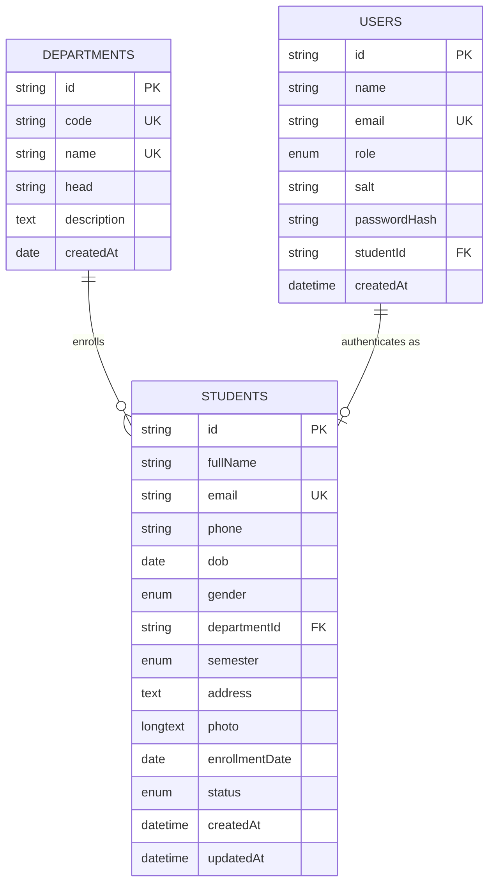

# Academic Project Report: Student Management System (EduMetrics SMS)

**Course:** Software Engineering / Web Application Architecture  
**Project Title:** Client-Side Responsive Student Management System with Cryptographic Authentication  
**Author / Team:** Senior Engineering Project  
**Date:** November 2026  
**System Architecture:** HTML5, CSS3, Vanilla JavaScript (ES6+), Web Crypto API, LocalStorage  

---

## 1. Project Introduction

Managing university student records, departmental allotments, enrollment statistics, and identity verification represents a foundational operational requirement in higher education institutions. Traditional enterprise administrative tools frequently introduce excessive setup complexity, requiring heavy runtime environments (e.g., Apache, PHP, .NET, Node.js) and database servers (e.g., MySQL, PostgreSQL), making them cumbersome for local demonstration, offline evaluation, and agile prototyping.

The **EduMetrics Student Management System (SMS)** addresses this challenge by delivering a comprehensive, enterprise-grade academic administration portal constructed entirely with **HTML5, plain CSS3, and Vanilla JavaScript (ES6+)**. Operating without external backend frameworks or server-side databases, the system leverages browser-native **LocalStorage** for ACID-compliant client persistence and the **Web Crypto API** for salted PBKDF2 password derivation.

---

## 2. Project Objectives

1. **Zero-Dependency Architecture:** Implement a complete, responsive administrative dashboard that executes directly inside standard modern web browsers via Live Server or static file hosting.
2. **Complete CRUD Lifecycle:** Provide full Create, Read, Update, and Delete operations for student profiles and academic departments.
3. **Relational Integrity in Key-Value Storage:** Enforce strict referential constraints (e.g., preventing the deletion of departments associated with registered students) across isolated LocalStorage document stores.
4. **Interactive Analytics & Dashboards:** Dynamically calculate enrollment distributions, gender demographics, department populations, and chronological trends using live data.
5. **Modern Security & Validation Demonstration:** Prevent insecure plaintext credential storage by applying Web Crypto PBKDF2 hashing with random 16-byte salts, while defending against Cross-Site Scripting (XSS) through DOM sanitization.
6. **Academic Rigor & Clear Relational Mapping:** Formalize a logical Entity-Relationship (ER) model and standard MySQL DDL (`schema.sql`) to demonstrate how document-based browser storage mirrors enterprise relational databases.

---

## 3. Technology Stack

| Layer | Technology | Usage / Justification |
|---|---|---|
| **Structure** | HTML5 (Semantic) | Semantic page markup (`<header>`, `<aside>`, `<main>`, `<section>`), accessible ARIA attributes, and native input validations. |
| **Styling** | Plain CSS3 | Custom SaaS-grade layout utilizing CSS Custom Properties (Variables), Flexbox, CSS Grid, and responsive media queries. **Zero CSS frameworks** (No Bootstrap, Tailwind, or Bulma). |
| **Scripting** | Vanilla JavaScript (ES6+) | Modular architecture with state management, debounce algorithms, asynchronous Web Crypto operations, and event orchestration. **Zero JS frameworks** (No React, Vue, Angular, or jQuery). |
| **Persistence** | Browser LocalStorage | Permanent client-side document storage for records across browser sessions (`sms_users`, `sms_students`, `sms_departments`, `sms_settings`). |
| **Session** | Browser SessionStorage | Temporary session tokens and user state cleared upon browser termination. |
| **Cryptography** | Web Crypto API (`window.crypto.subtle`) | Industry-standard PBKDF2 key derivation with 100,000 iterations of SHA-256 and unique 16-byte salts for credential hashing. |
| **Visualization** | Chart.js (CDN) | Interactive bar charts for enrollment trends and doughnut charts for demographic distributions (with integrated canvas/CSS fallbacks). |
| **Icons & Typography**| Font Awesome 6.5 & Inter Font | Vector iconography and clean, legible typography for dashboard interfaces. |

---

## 4. System Features

### Module 1: Dynamic Dashboard (`index.html`)
* **KPI Metrics:** Computes Total Students, Active Students, Inactive Students, and Total Academic Departments directly from LocalStorage.
* **Enrollment Distribution Chart:** Visualizes student density across semesters (1st through 8th) using dynamic Chart.js canvas elements.
* **Demographic Ratio:** Renders a doughnut chart displaying Female, Male, and Other gender breakdowns.
* **Faculty Enrollment Bars:** Renders progress bars displaying the percentage of the student body enrolled in each academic department.
* **Recent Activity Feed:** Displays the 5 most recently admitted students with direct links to full dossiers.
* **Student Role Adaptation:** Greets authenticated students with their profile information while concealing administrative management buttons.

### Module 2: Student Management Directory (`students.html`)
* **Responsive Data Table:** Displays comprehensive student attributes with profile avatars and status badges.
* **Live Multi-Criteria Filtering:** Simultaneous filtering across Department, Semester, and Status (Active/Inactive).
* **Debounced Search:** Real-time text search querying student legal names, student IDs, emails, and phone numbers without UI lag.
* **Dynamic Column Sorting:** Clickable table column headers enabling bi-directional ascending and descending sorts.
* **Interactive Pagination:** Page size selection (5, 10, 25, 50 per page) with numbered controls and record counters.
* **Custom Modal Deletion:** High-friction confirmation modal dialog replacing native browser alerts.

### Module 3: Student Registration & Modification (`add-student.html`)
* **Dual Operation Mode:** Functions as an "Add Student" registration form or an "Edit Student" modifier depending on the presence of the `?id=` query parameter.
* **Automated ID Generation:** Sequences unique student IDs (e.g. `STU-2024-011`) by checking current year counters.
* **Validation Engine:** Rigorous regular expression checks for email formats, telephone standards, date-of-birth constraints (minimum age 14), and duplicate email/ID collisions.
* **Base64 Photo Processing:** Integrated file reader converting uploaded images into Base64 strings for local persistence with instant live preview.

### Module 4: Student Details Dossier (`student-details.html`)
* **Profile Header:** Hero card displaying the student's portrait, legal name, registration ID, department, and active status.
* **Information Breakdown:** Categorized cards organizing Academic Details, Personal Demographics, and Contact Information.
* **URL Parameter Integration:** Decoupled architecture loading student dossiers via query string parameters (`?id=STU-2024-001`).
* **Print Engine:** Dedicated `@media print` CSS rules allowing single-click clean dossier printing without navigation clutter.

### Module 5: Settings & Data Operations (`settings.html`)
* **Department CRUD:** Create, read, and edit academic departments.
* **Referential Integrity Enforcement:** Blocks department deletion if existing students are currently enrolled under its foreign key.
* **JSON Backup Export:** Serializes the entire application state into a timestamped downloadable `.json` file.
* **JSON Backup Import:** Reads, validates, and imports external student records with schema verification.
* **Demo Data Reset & Wipe:** Restores original sample datasets or purges application storage on demand.

### Module 6: Authentication & Role-Based Access Control
* **Demonstration RBAC:** Distinguishes between `Admin` and `Student` roles.
* **Client-Side PBKDF2 Hashing:** Salts and hashes passwords before storing them in `sms_users`.
* **Route Guards:** Automatically redirects unauthenticated users to `login.html` and restricts `settings.html` to administrators.

---

## 5. System Architecture

The application adopts a modular, decoupled architecture where HTML views communicate exclusively through clean service APIs:

```
+-----------------------------------------------------------------------------------+
|                                  USER BROWSER                                     |
|                                                                                   |
|  +-----------------------------------------------------------------------------+  |
|  |                           PRESENTATION LAYER (HTML5)                        |  |
|  |   index.html | students.html | add-student.html | student-details.html       |  |
|  |   settings.html | login.html | register.html                                |  |
|  +-----------------------------------------------------------------------------+  |
|                                        |                                          |
|  +-----------------------------------------------------------------------------+  |
|  |                           STYLING LAYER (Plain CSS3)                        |  |
|  |   style.css | dashboard.css | students.css | forms.css | auth.css          |  |
|  |   responsive.css                                                            |  |
|  +-----------------------------------------------------------------------------+  |
|                                        |                                          |
|  +-----------------------------------------------------------------------------+  |
|  |                        BUSINESS LOGIC & DOMAIN CONTROLLERS                  |  |
|  |   app.js (Lifecycle & Guard)        | student.js (Student Service)          |  |
|  |   dashboard.js (Analytics Engine)   | students.js (Table & Filter Engine)   |  |
|  |   settings.js (Dept & Backup)       | student-details.js (Profile Dossier)  |  |
|  +-----------------------------------------------------------------------------+  |
|                      |                                   |                        |
|  +---------------------------------------+  +----------------------------------+  |
|  |         SECURITY & UTILITIES          |  |       DATA ACCESS LAYER          |  |
|  |   auth.js (Web Crypto PBKDF2)         |  |   storage.js (LocalStorage CRUD)|  |
|  |   validation.js (Form Regex & Rules)  |  |   Referential Integrity Engine   |  |
|  |   utils.js (DOM, Modal, Toast, Sanit) |  |   JSON Exporter / Importer       |  |
|  +---------------------------------------+  +----------------------------------+  |
|                      \                                   /                        |
|  +-----------------------------------------------------------------------------+  |
|  |                      STORAGE ENGINE (Browser LocalStorage)                  |  |
|  |   sms_users | sms_students | sms_departments | sms_settings | sms_session   |  |
|  +-----------------------------------------------------------------------------+  |
+-----------------------------------------------------------------------------------+
```

---

## 6. Data Structure: LocalStorage vs. Relational Modeling

Because this application runs entirely client-side, traditional relational tables are modeled as structured JSON arrays inside distinct LocalStorage keys:

| Storage Key | Relational Equivalent | Entity Purpose |
|---|---|---|
| `sms_departments` | `departments` table | Primary entity defining academic faculties and codes. |
| `sms_students` | `students` table | Dependent entity referencing `departmentId` via foreign key logic. |
| `sms_users` | `users` table | Security entity holding salted PBKDF2 hashes and optional `studentId` links. |
| `sms_settings` | `system_settings` table | Application-wide parameters (institution name, term, pagination limits). |
| `sms_session` | Session cache / Cookie | Active user session persisted in `sessionStorage` and synchronized with `localStorage`. |

---

## 7. Entity-Relationship Diagram



### Referential Integrity Implementation in JavaScript:
In traditional SQL databases, referential integrity is enforced by the DBMS engine via foreign key constraints (`ON DELETE RESTRICT`). In EduMetrics SMS, this is implemented within `SMS.Settings`:
```javascript
const studentCount = students.filter(s => s.departmentId === dept.id).length;
if (studentCount > 0) {
  SMS.Utils.showToast('error', 'Integrity Error', 
    `Cannot delete department: ${studentCount} students are currently enrolled.`);
  return;
}
```

---

## 8. User Interface Layout & Screenshots Guide

```
+----------------------------------------------------------------------------------------------+
| [EduMetrics Logo]  Academic Dashboard                      [Term: 2026-2027] [Admin] [Logout]|
+------------------+---------------------------------------------------------------------------+
| (Sidebar)        |  +---------------------------------------------------------------------+  |
| - Dashboard      |  | Student Management System: Monitor enrollment dynamics & departments |  |
| - Student Dir    |  +---------------------------------------------------------------------+  |
| - Add Student    |                                                                           |
| - Settings       |  [ Total: 10 ]      [ Active: 8 ]     [ Inactive: 2 ]    [ Depts: 5 ]     |
|                  |                                                                           |
|                  |  +-------------------------------+ +-----------------------------------+  |
|                  |  | Semester Enrollment (Chart)   | | Gender Distribution (Chart)       |  |
|                  |  +-------------------------------+ +-----------------------------------+  |
|                  |                                                                           |
|                  |  +-------------------------------+ +-----------------------------------+  |
|                  |  | Recent Enrolled Students      | | Department Distribution           |  |
|                  |  | - Sarah Jenkins (CSE) Active  | | - CSE: 30% [=======>           ]  |  |
|                  |  | - Alex Rivera (CSE) Active    | | - EEE: 20% [====>              ]  |  |
|                  |  | - Priya Sharma (EEE) Active   | | - BBA: 20% [====>              ]  |  |
|                  |  +-------------------------------+ +-----------------------------------+  |
+------------------+---------------------------------------------------------------------------+
```

### Visual Specifications:
1. **Typography & Styling:** Utilizes a modern system font stack (`Inter`, system UI) with a primary blue SaaS palette (`#2563eb`), dark slate navigation (`#0f172a`), and neutral card surfaces (`#ffffff`).
2. **Component Modularity:** Cards, form inputs, buttons, tables, badges, modals, and toast alerts are defined using reusable CSS utility classes.
3. **Mobile Responsiveness:** At viewport widths under 1024px, the sidebar transitions into a slide-out drawer with a backdrop blur overlay. Tables preserve layout integrity via container scroll wraps.

---

## 9. System Limitations

1. **Client-Side Storage Limits:** Browser LocalStorage is bounded by domain storage quotas (typically 5MB to 10MB). Storing hundreds of high-resolution Base64 photographs will eventually exceed this quota.
2. **Demonstration Authentication Boundary:** While PBKDF2 hashing provides authentic client cryptographic demonstration, browser-based authentication cannot enforce true server-side secrecy, as client execution memory is accessible via developer inspection tools.
3. **Absence of Server-Side Prepared Statements:** Prepared statements (`PDO::prepare()`, `mysqli_stmt`) are native server-side database constructs and cannot run inside browser-only JavaScript runtimes.
4. **Single-Browser Isolation:** Records created in one user's browser do not synchronize across separate devices without manual JSON export and import.

---

## 10. Future Improvements & Conclusion

### Future Improvements
1. **IndexedDB Engine:** Migrate from LocalStorage to IndexedDB to accommodate larger datasets, high-resolution student ID photos, and binary file attachments.
2. **Node.js / Express & MySQL Backend:** Develop a RESTful backend API utilizing Express and MySQL with prepared statements and JWT authorization to transition this frontend into a multi-tier enterprise architecture.
3. **CSV & PDF Reporting:** Integrate client-side PDF document generation (e.g. `pdfmake` or `jsPDF`) to export official student transcripts and identity cards.
4. **Dark Mode Theme:** Implement CSS variable toggling for system-wide light/dark theme preference detection.

### Conclusion
The **EduMetrics Student Management System** successfully accomplishes all requirements specified for a comprehensive university semester project. Built strictly with vanilla web technologies, the application delivers a polished, responsive administration experience with complete CRUD capabilities, real-time analytics, referential data constraints, and cryptographic credential hashing. The project stands as a modular, maintainable, and aesthetically modern architecture suitable for rigorous academic evaluation.
